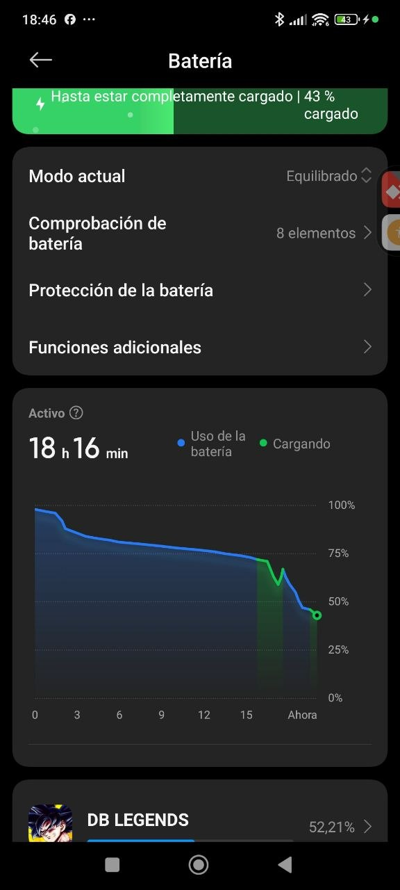

Mi dispositivo es un Xiaomi 11T Pro, con las siguiente especificaciones:
RAM: 8GB
PROCESADOR: Snapdragon 888 (5nm)
ALMACENAMIENTO: 256GB (14GB LIBRES)
PANTALLA: 6,67" 1080X2400 335ppi
DENSIDAD: 440 dpi
VERSION ANDROID: Android 14

Sensores: Según la web de Xiaomi tiene sensor de proximidad, de luz ambiental, acelerómetro, 
giroscopio, brújula, barómetro, sensor de temperatura de color, infrarrojos y un motor de vibración 
lineal. También tiene GPS de doble frecuencia, NFC y huella en el lateral

Batería de 5000mAh de dos celdas de 2500mAh (cambiada hace menos de un año), en buen estado.
43% de carga, salud buena, 31ºC cargando por USB desde el ordenador (para ADB)

Conclusiones:

Mi movil trabaja a 440dpi, más aún que el Pixel 8 y  casi el doble que le Nexus S.
Un botón de 48dp ocupa más píxeles en mi movil que en un Nexus por la densidad de 
píxeles, ambos ocupan el mismo tamaño, por eso los botones hay que medirlos en dp,
aunque la letra hay que medirla en sp para que se adapte si alguien pone la letra
grande

Es normal que la gente tenga la capacidad del movil casi a tope porque es un lío
borrar videos y fotos, así que es esencial que la aplicación ocupe lo menos posible,
limitar lo que se guarda en caché y avisar si no hay espacio para evitar el riesgo
de perder el savegame

La mayoría de mi batería se la ha llevado un juego un 3D, un movil moderno en estático
consume muy poca batería, lo que más gasta son los gráficos y la pantalla. Para un juego
idle, el proceso de cálculo de números consume muy poco