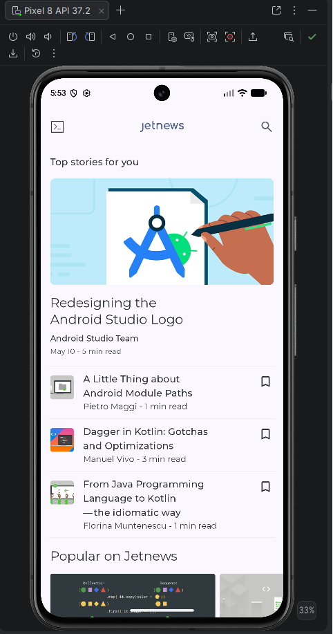
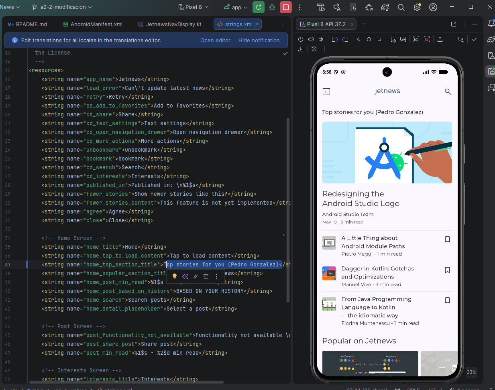

# A2.2 · Modificar una app existente

## Qué he cambiado

El título de la sección principal de la pantalla de inicio de Jetnews.
Antes ponía "Top stories for you" y ahora pone "Top stories for you
(Pedro Gonzalez)"

## Dónde y por qué ahí

En app/src/main/res/values/strings.xml, en la línea 37, que es el recurso
home_top_section_title. El texto de esa sección sale de ese recurso (se lee
con stringResource en HomeScreens.kt), así que bastaba con cambiar el valor
ahí y no hizo falta tocar nada del código Kotlin

## Cómo lo he comprobado

Ejecuté la app en el emulador (Pixel 8, API 37.2) antes de cambiar nada y
saqué una captura de la pantalla de inicio. Después cambié el recurso,
volví a ejecutarla y comprobé que el texto nuevo aparece arriba de la
lista de artículos.

El cambio está en la rama a2-2-modificacion, commit 2dd00013.

Antes:

Después:

