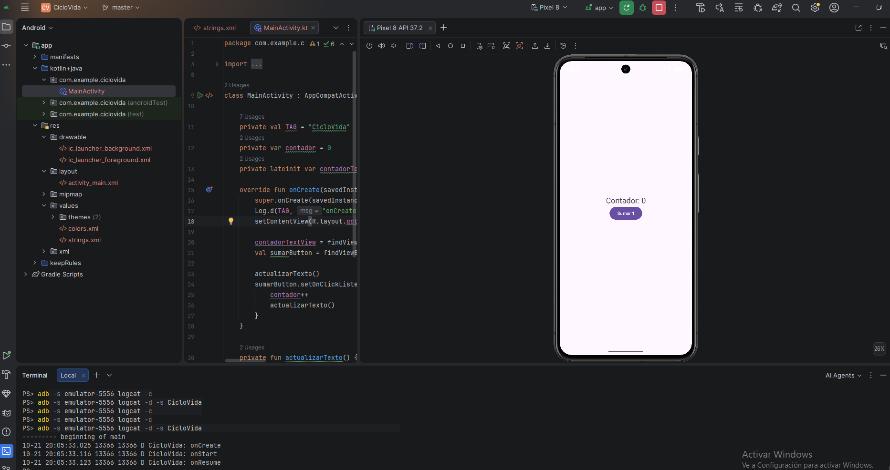
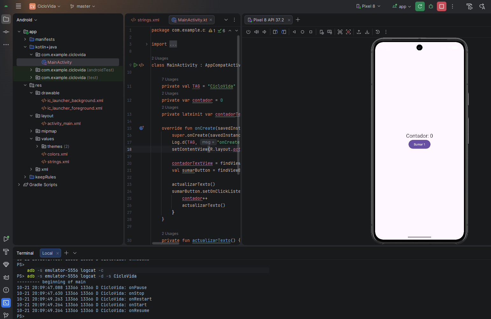
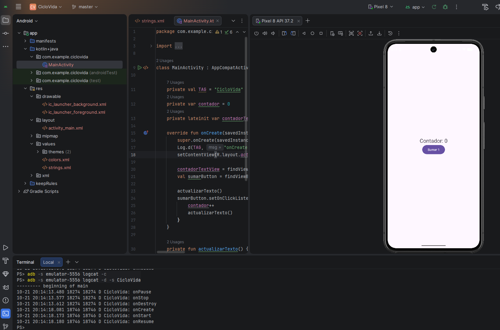
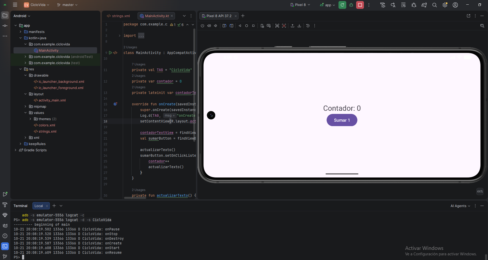
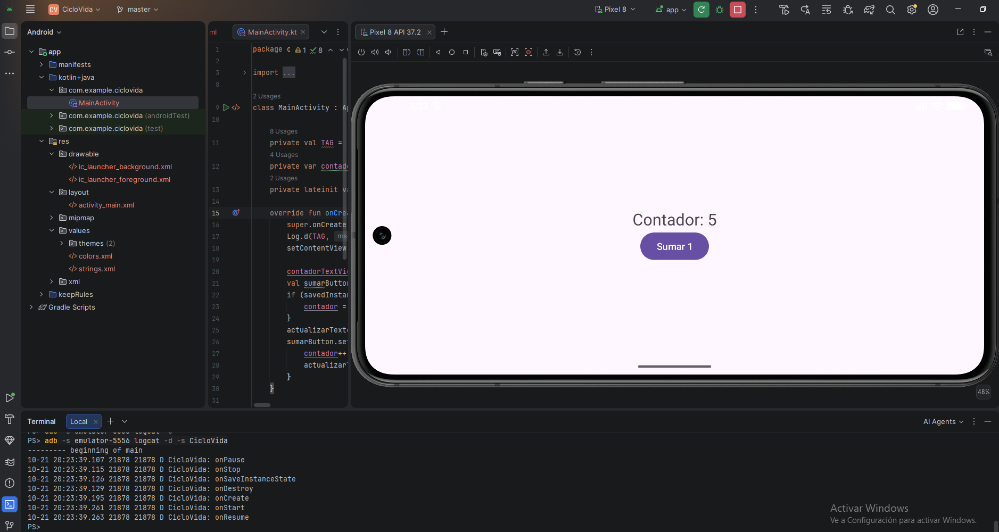

# A2.3 · Experimento de ciclo de vida

## Qué orden siguen los callbacks

Puse un Log.d con la etiqueta CicloVida en los callbacks de MainActivity
(onCreate, onStart, onResume, onPause, onStop, onDestroy, y también
onRestart) y los leí con adb logcat. Lo que salió:

- Al arrancar la app: onCreate, onStart, onResume
- Al pulsar el botón de inicio: onPause, onStop. La app queda parada pero
  sigue viva
- Al pulsar atrás y reabrir la app desde su icono: salió onRestart,
  onStart, onResume, sin onCreate. O sea, en mi emulador (Pixel 8)
  atrás no destruye la Activity, la manda a segundo plano como el
  botón de inicio
- Al cerrar la app desde recientes (deslizándola) y abrirla de nuevo:
  onPause, onStop, onDestroy, y al reabrir onCreate, onStart, onResume.
  Además el número de proceso del log cambió (de 8612 a 9583), porque el
  proceso murió y se creó otro
- Al rotar la pantalla: onPause, onStop, onDestroy, onCreate, onStart y onResume






## Qué pasa al rotar sin guardar nada

La app tiene un contador que se suma con un botón. Girar la pantalla 
es un cambio de configuración: Android destruye la Activity y la crea 
de nuevo, y como el contador era una variable en memoria, se pierde

## Cómo lo he arreglado

Guardo el contador en el Bundle de onSaveInstanceState y lo recupero en
onCreate, antes de actualizar el texto:

```kotlin
override fun onSaveInstanceState(outState: Bundle) {
    super.onSaveInstanceState(outState)
    outState.putInt("contador", contador)
    Log.d(TAG, "onSaveInstanceState")
}
```

```kotlin
// En onCreate, antes de actualizarTexto()
if (savedInstanceState != null) {
    contador = savedInstanceState.getInt("contador")
}
```

onSaveInstanceState se llama antes de que Android destruya la Activity.
Lo que meto en el Bundle llega de vuelta como savedInstanceState en el
onCreate siguiente. Tiene que ir antes de actualizarTexto(), porque si no
el texto se pinta con el valor 0


## Comprobación de que funciona

Sumé hasta 5 con el botón, roté el emulador y el contador siguió en  5.
En el log salió onSaveInstanceState después de onStop



## Por qué no es persistencia

Esto solo sirve cuando el sistema recrea la Activity. Si cierro la app
desde recientes y la abro de nuevo, savedInstanceState es null y el
contador empieza otra vez en 0. Para guardar datos  de verdad haría falta 
una base de datos o preferencias