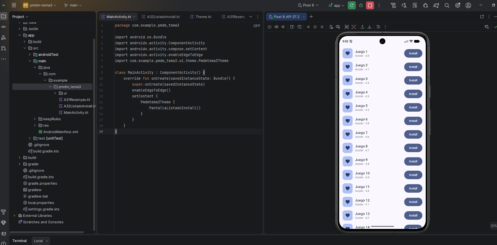
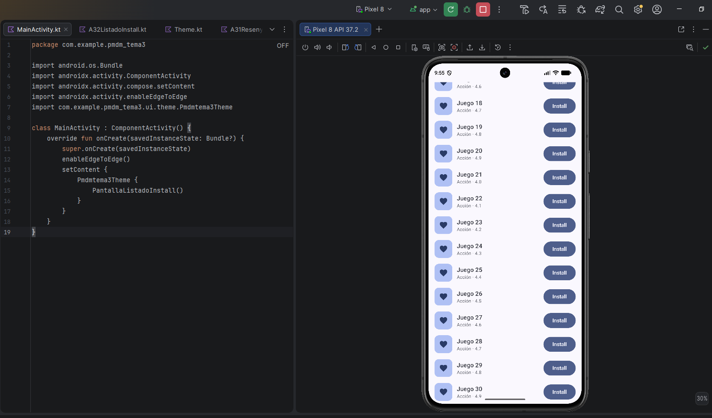

# A3.2 · Listado con LazyColumn

Repo
https://github.com/JacoboRamiro/pmdm-practicas/tree/main/tema3

## Qué composables de estructura has usado y por qué

Hice un composable propio, FilaListadoInstall, que recibe el nombre y la
categoría como parámetros, más un modifier opcional. Por dentro tiene:

- Row: es el contenedor de la fila. Coloca en horizontal el icono, los dos
  textos y el botón, y con verticalAlignment = Alignment.CenterVertically
  los centro en vertical
- Box: para el icono de la izquierda. Es un cuadrado de esquinas
  redondeadas con el icono dentro, y como el icono va sobre el fondo hace
  falta un Box
- Column: apila el nombre y la categoría. Lleva Modifier.weight(1f) para
  que ocupe el espacio que sobra y el botón se quede pegado a la derecha

Para el listado uso un LazyColumn con items(30), que genera 30 filas
inventadas ("Juego 1", "Juego 2"...). Lo meto dentro de un Surface para
que tenga el color de fondo del tema, y le pongo statusBarsPadding() para
que la primera fila no quede debajo de la barra de estado

## Qué componentes comunes has usado y para qué

- Text: el nombre con el estilo titleMedium y la categoría con bodySmall y
  el color onSurfaceVariant, para que quede más apagada que el nombre
- Icon: el corazón de la izquierda. Le puse contentDescription = null
  porque es decorativo, el texto de al lado ya dice de qué es la fila
- Button: el botón "Install". El onClick está vacío porque de momento no
  tiene que hacer nada

Los colores salen de MaterialTheme.colorScheme (primaryContainer para el
fondo del icono y onPrimaryContainer para el propio icono), no escribí
ninguno a mano

## Por qué LazyColumn y no Column

Una Column compone todos sus hijos de golpe. Con 30 filas, crea los 30
composables aunque en el Pixel 8 solo se ven unos 13. LazyColumn solo
compone los que se ven o están a punto de verse, y los va reciclando al
hacer scroll, igual que hacía RecyclerView

Con 30 elementos ya tiene sentido, y en una lista real, como un catálogo
de apps que puede crecer a cientos, la diferencia sería mucho mayor. Además
el LazyColumn describe cómo se dibuja un elemento con items(30) { indice ->
... }, porque necesita generarlos según se van necesitando. Una Column
solo la usaría para una lista fija y corta, como un menú de cuatro
opciones
