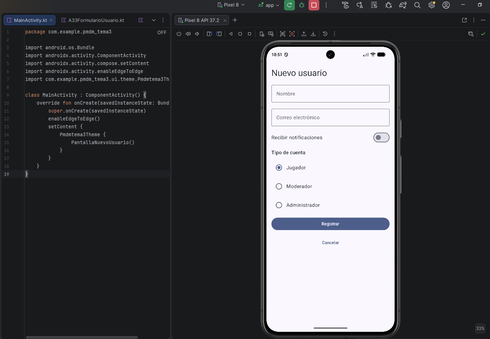

# A3.3 · Formulario de nuevo usuario

Repo
https://github.com/JacoboRamiro/pmdm-practicas/tree/main/tema3

## Qué composables de estructura has usado y por qué

La pantalla es una Column con scroll (verticalScroll con un
rememberScrollState) que apila el título y todos los campos del
formulario. Uso Column y no LazyColumn porque son pocos elementos y fijos,
y el scroll lo pongo por si en un móvil pequeño o en horizontal no cabe
todo. Entre elementos dejo 12 dp con Arrangement.spacedBy, y la envuelvo en
un Surface para que tenga el fondo del tema y en un statusBarsPadding()
para que el título no quede debajo de la barra de estado

Dentro hay dos Row:

- Una para "Recibir notificaciones" y el Switch, con
  Arrangement.SpaceBetween para que el texto quede a la izquierda y el
  interruptor a la derecha, y los dos centrados en vertical
- Otra por cada opción del tipo de cuenta, con el RadioButton y su texto
  uno al lado del otro. Las genero con un forEach sobre la lista de roles

## Qué componentes comunes has usado y para qué

- OutlinedTextField (dos): nombre y correo electrónico. No guardan el texto
  por sí solos, reciben el valor actual y un onValueChange, así que
  guardo cada uno en una variable con remember { mutableStateOf("") }. Sin
  eso, lo que escribes no aparecería
- Switch: para "Recibir notificaciones", porque es un ajuste de activado o
  desactivado
- RadioButton (tres): Jugador, Moderador y Administrador. Compose no los
  agrupa, así que la exclusión la programé yo: guardo la opción elegida en
  la variable rol y cada botón está seleccionado solo si rol == su opción.
  Al pulsar uno, rol cambia y los demás se desmarcan
- Button: "Registrar", que es la acción principal, así que tiene el peso
  visual más alto, relleno de color
- TextButton: "Cancelar", que es una acción secundaria y poco intrusiva,
  solo texto
- Text: el título, las etiquetas y los nombres de las opciones

Los dos botones tienen el onClick vacío, porque el enunciado dice que el
formulario no tiene que hacer nada al enviarse. Eso se trabajará más
adelante con el estado
