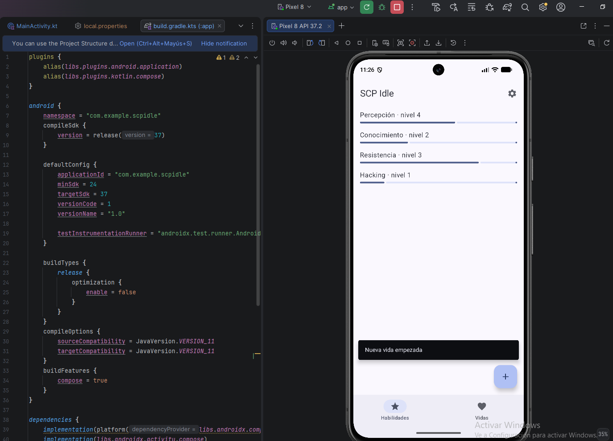

# A3.4 · Pantalla completa con Scaffold

Código: app/src/main/java/com/example/scpidle/ui/pages/PantallaPrincipal.kt
(en este mismo repositorio)

## Qué composables de estructura has usado y por qué

La pantalla se monta sobre un Scaffold, que ya sabe colocar las piezas
típicas de una pantalla y solo hay que decirle qué poner en cada hueco:

- topBar: una TopAppBar con el título "SCP Idle" y un icono de ajustes
  como acción
- bottomBar: una NavigationBar con dos secciones, Habilidades y Vidas.
- floatingActionButton: un botón flotante para empezar una vida nueva, que
  es la acción más importante de la app
- snackbarHost: donde aparece el aviso temporal

El contenido es un LazyColumn y no una Column porque tanto las habilidades
como las vidas son listas que pueden crecer, y así solo se componen las
filas que se ven. Qué lista se muestra depende de una variable (seccion,
guardada con remember { mutableIntStateOf(0) }): si vale 0 salen las
habilidades y si vale 1, las vidas. Es un cambio de contenido sencillo,
sin navegación real, que llegará en una unidad posterior

## Qué componentes comunes has usado y para qué

- TopAppBar con un IconButton y un Icon de ajustes (con
  contentDescription, porque el icono es el único texto que tiene el
  botón). De momento no hace nada
- NavigationBarItem (dos): cada uno con su icono (una estrella para
  Habilidades y un corazón para Vidas) y su etiqueta. El seleccionado se
  marca comparando seccion con su número
- FloatingActionButton con un icono de más y la descripción "Nueva vida".
  Al pulsarlo muestra el snackbar "Nueva vida empezada"
- SnackbarHost con un SnackbarHostState. Mostrar un snackbar es una
  operación que espera, así que se lanza con una corrutina desde
  rememberCoroutineScope. Le puse duración Long para que dé tiempo a hacer
  la captura
- FilaSkill y FilaVida, los componentes de fila que ya tenía de la pantalla
  de inicio, con los datos de ejemplo

## Cómo he aplicado el paddingValues

El contenido del Scaffold recibe un paddingValues, que es el espacio que
ocupan las barras. Se lo apliqué al LazyColumn con
Modifier.padding(paddingValues). Si no lo hago, la primera fila queda
tapada por la barra superior y la última por la barra inferior
