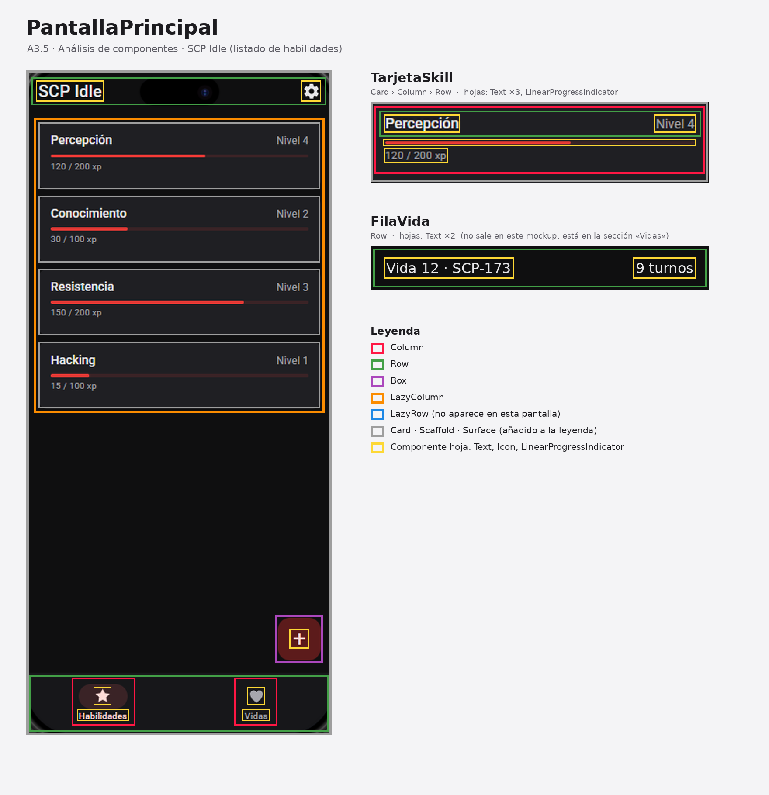
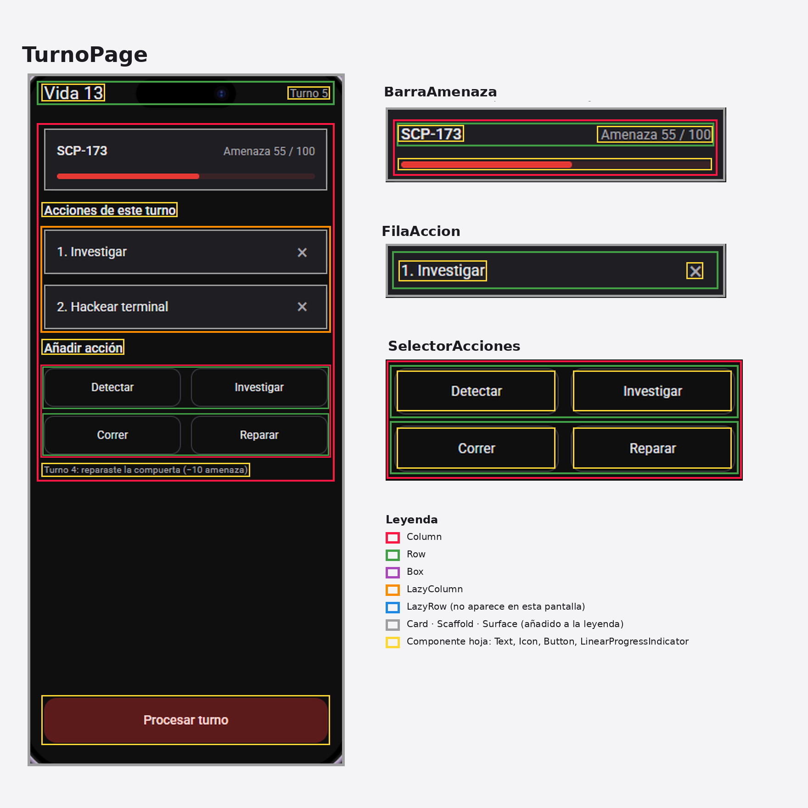
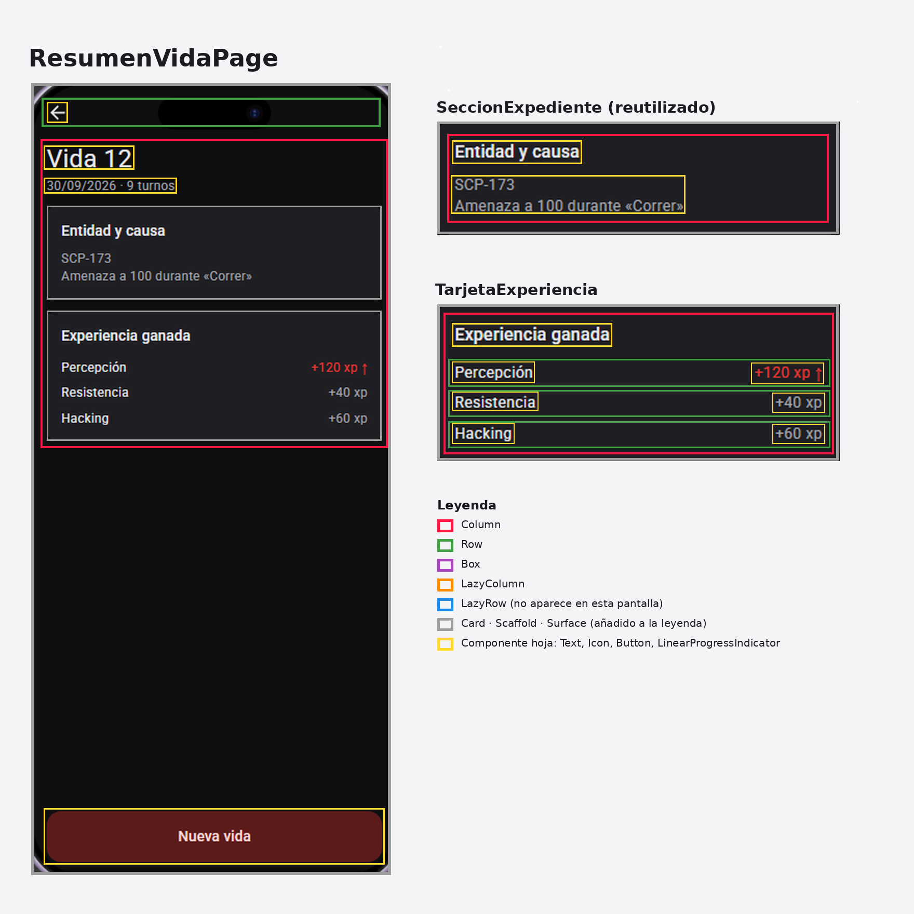
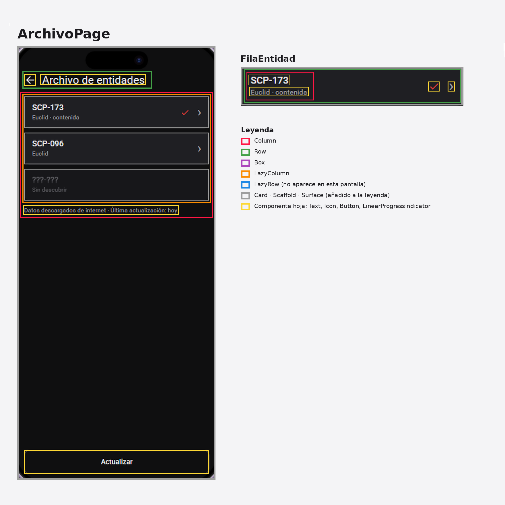
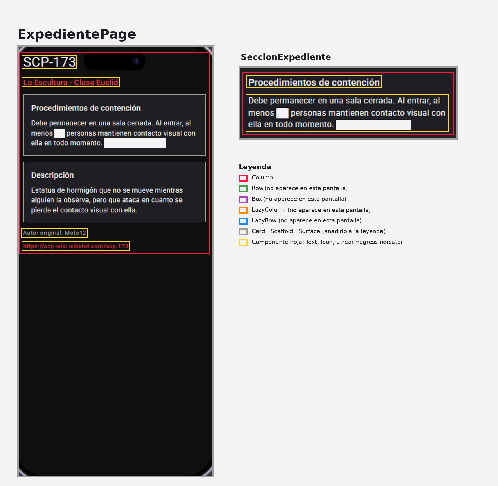

# A3.5 · Análisis de componentes del mockup del Proyecto A

## Qué pantallas he analizado

Analicé las cinco pantallas del mockup de la propuesta: PantallaPrincipal
(el listado de habilidades, que hace de Inicio), TurnoPage, ResumenVidaPage,
ArchivoPage y ExpedientePage. Para cada una hice una lámina con la pantalla
completa a la izquierda y, al lado, un recorte de cada componente
repetido o relevante con su nombre en PascalCase

## Leyenda de colores

Seguí la leyenda del enunciado: rojo para Column, verde para Row, morado
para Box, naranja para LazyColumn y azul para LazyRow. Los componentes
hoja (Text, Icon, Button, LinearProgressIndicator) los marqué con un
contorno amarillo. Como Card, Scaffold y Surface salen en el código y no
están en la leyenda, les añadí un color gris. En ninguna de las cinco
pantallas hay un LazyRow

## Tabla de componentes

| Componente | Contenedores | Componentes hoja | Parámetros |
|---|---|---|---|
| TarjetaSkill | Card → Column → Row | Text (nombre), Text (nivel), LinearProgressIndicator, Text (experiencia) | skill (nombre, nivel, experiencia y experiencia para el siguiente nivel), modifier |
| FilaVida | Row | Text (vida y entidad), Text (turnos) | vida (número, entidad y turnos), modifier |
| SeccionExpediente | Card → Column | Text (título), Text (texto) | titulo, texto, modifier |
| BarraAmenaza | Card → Column → Row | Text (entidad), Text (amenaza), LinearProgressIndicator | entidad, amenaza, amenazaMaxima, modifier |
| FilaAccion | Card → Row | Text (orden y acción), Icon (quitar) | orden, accion, onQuitar, modifier |
| SelectorAcciones | Column → Row ×2 | Button ×4 | acciones, onElegir, modifier |
| TarjetaExperiencia | Card → Column → FilaExperiencia ×3 | Text (título) | experiencias (habilidad y experiencia ganada), modifier |
| FilaExperiencia | Row | Text (habilidad), Text (experiencia) | habilidad, experiencia, subeNivel, modifier |
| FilaEntidad | Card → Row → Column | Text (código), Text (clase y estado), Icon (contenida), Icon (flecha) | entidad, contenida, onClick, modifier |
| PantallaPrincipal | Scaffold → barra superior en fila, LazyColumn de TarjetaSkill, botón flotante (Box) y barra inferior en fila, con cada sección como columna de icono y texto | Text e Icon de la barra superior, Icon del botón flotante, Icon y Text de cada sección | De momento ninguno, lee los datos de ejemplo |
| TurnoPage | Scaffold → barra superior en fila, Column con BarraAmenaza, LazyColumn de FilaAccion y SelectorAcciones, y el botón abajo | Text de la barra superior, de los títulos y del resultado del turno anterior, Button «Procesar turno» | Aún no programada: recibirá el estado del turno |
| ResumenVidaPage | Scaffold → barra superior en fila, Column con SeccionExpediente y TarjetaExperiencia, y el botón abajo | Icon (volver), Text (vida), Text (fecha y turnos), Button «Nueva vida» | Aún no programada: recibirá la vida |
| ArchivoPage | Scaffold → barra superior en fila, Column con LazyColumn de FilaEntidad y un Text, y el botón abajo | Icon (volver), Text (título), Text (actualización), Button «Actualizar» | Aún no programada: recibirá la lista de entidades |
| ExpedientePage | Surface → Column con scroll | Text (código), Text (nombre y clase), Text (autor), Text (enlace) | entidad, modifier |

FilaVida no sale en el mockup del listado, porque se ve en la sección
«Vidas», así que en la lámina la reproduje con los colores del tema.

## Qué cambia según los datos y qué es fijo

En TarjetaSkill cambian el nombre, el nivel, la experiencia y el progreso,
que llegan en el parámetro skill, y la estructura es siempre la misma. Lo
mismo pasa con BarraAmenaza (la entidad y la amenaza), FilaAccion (el
orden y la acción), FilaExperiencia (la habilidad y la experiencia) y
FilaEntidad (el código, la clase y si está contenida)

SeccionExpediente es el mismo componente en ExpedientePage y en
ResumenVidaPage: solo cambian el título y el texto, así que no hace falta
hacer otro

Uso LazyColumn donde hay una colección que puede crecer: las habilidades,
las acciones del turno y las entidades del archivo. Donde los elementos
son pocos y fijos (los cuatro botones de SelectorAcciones, las secciones
del expediente o las tres filas de experiencia) basta con Column y Row

## Qué falta programar

TurnoPage, ResumenVidaPage y ArchivoPage están analizadas, pero aún no
están programadas. Sus componentes los haré en las siguientes unidades,
como permite la A3.6
