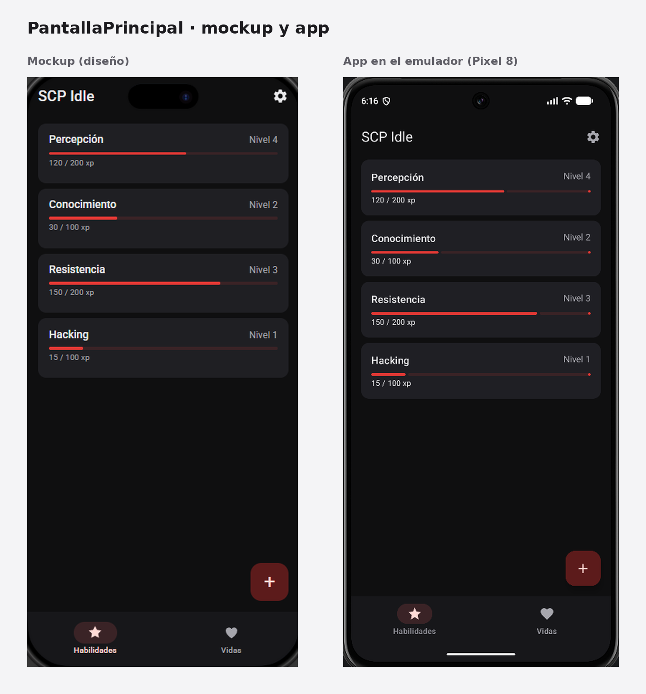
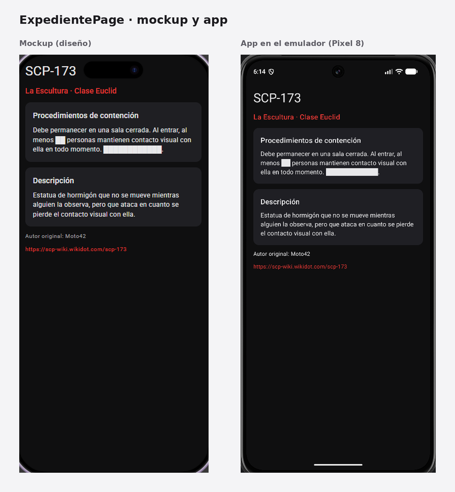

# A3.6 · Componentes y páginas del Proyecto A en Compose

Los componentes y las páginas están en este mismo repositorio, dentro de
app/src/main/java/com/example/scpidle/ui

## Componentes

Hice tres componentes en el paquete ui/components, cada uno con los datos
como parámetros, un modifier opcional y su @Preview:

- TarjetaSkill: la tarjeta de una habilidad, con su nombre, nivel, barra
  de progreso y experiencia
- FilaVida: una fila del historial de vidas, con el número de vida, la
  entidad y los turnos
- SeccionExpediente: una tarjeta con un título y un texto, que uso para
  las secciones del expediente

Ninguno lleva textos escritos dentro: todo llega por parámetros, y los
datos de ejemplo están en DatosEjemplo.kt.

## Páginas

Hice dos páginas en el paquete ui/pages:

- PantallaPrincipal: es el listado. Usa un Scaffold con barra superior,
  barra inferior, botón flotante y snackbar, y dentro un LazyColumn con
  las TarjetaSkill o las FilaVida, según la sección elegida
- ExpedientePage: es el detalle de una entidad. No usa Scaffold, ni menú
  lateral ni navegación, solo una Column con scroll con dos
  SeccionExpediente

## Comparación con el mockup

Hice primero el diseño en Figma y después adapté la app a él. En cada
imagen, a la izquierda está el diseño y a la derecha el resultado en el
emulador (Pixel 8)

La estructura, los espaciados (16 de margen, 8 entre tarjetas en el
listado y 12 en el expediente), la jerarquía de textos y los colores son
los del diseño. Para que los colores coincidieran, en Theme.kt puse un
esquema oscuro fijo con los colores del diseño y sin colores dinámicos,
porque con estos Android usa los del fondo de pantalla del móvil. Los
iconos pueden verse algo distintos, porque en la app uso los iconos de
Material y en el diseño no

## Qué falta

No hay navegación entre las páginas ni lógica, solo datos de ejemplo,
porque el enunciado deja eso para unidades posteriores
